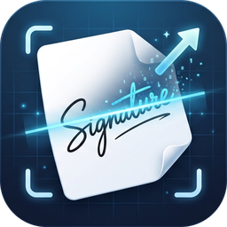

<p align="center"></p>

# 签名提取工具

从照片或扫描件中提取手写签名，去掉纸张背景、阴影和杂点，输出透明背景的 PNG（默认最大 280×80）。

## 功能

- **单张 / 批量提取**：可添加单张图片，也可添加整个文件夹（含子文件夹）一次性处理
- **只保留签字**：自动去除背景、光照不均、阴影、杂点、纸张边缘和表格线，只保留最主要的签名区域
- **尺寸模式**
  - 紧贴签名（默认）：等比缩放，去掉多余空白，宽高不超过设定值
  - 固定画布：严格输出设定尺寸，签名居中
  - 拉伸填满：无空白，但字形会变形
- **竖向签名自动转正**：签名高明显大于宽时自动旋转 90° 变为水平；方向反了可对单张图片手动旋转
- **输出选项**：透明 / 白色背景，墨色可选黑色、原墨色、深蓝、红色，灵敏度可调
- 支持 jpg、png、bmp、tif、webp，支持中文路径和手机照片的 EXIF 方向

## 使用

到 [Releases](../../releases) 下载 `签名提取工具.exe`，双击运行即可，无需安装 Python。

1. 点「添加图片」或「添加文件夹」，也可以把图片/文件夹直接拖到 exe 图标上打开
2. 在列表中点击图片可预览：上方红框为识别到的签名区域，下方为提取结果
3. 点「提取选中」或「全部提取」

输出目录留空时，结果保存到原图所在文件夹下的 `签名提取` 子文件夹，文件名为 `原文件名_签名.png`。

## 从源码运行 / 打包

```bash
python -m venv .venv
.venv\Scripts\python.exe -m pip install -r requirements.txt
.venv\Scripts\python.exe signature_extractor.py
```

命令行批量处理：

```bash
.venv\Scripts\python.exe signature_extractor.py --cli 图片或文件夹 [-o 输出目录]
```

打包成单文件 exe（输出到 `dist/`）：

```bash
.venv\Scripts\python.exe build.py
```

## 实现说明

只依赖 numpy 和 Pillow（不用 OpenCV，打包后约 18MB）：

1. 估计纸张背景并做除法归一化，消除阴影和光照不均
2. Otsu 自动阈值二值化，按灵敏度微调
3. 连通域分析去掉噪点、贴边长线和表格线
4. 膨胀聚类，把相邻笔画合成一组，保留墨迹最多的签名区域
5. 按墨迹深浅生成平滑透明度，裁剪、缩放后输出
